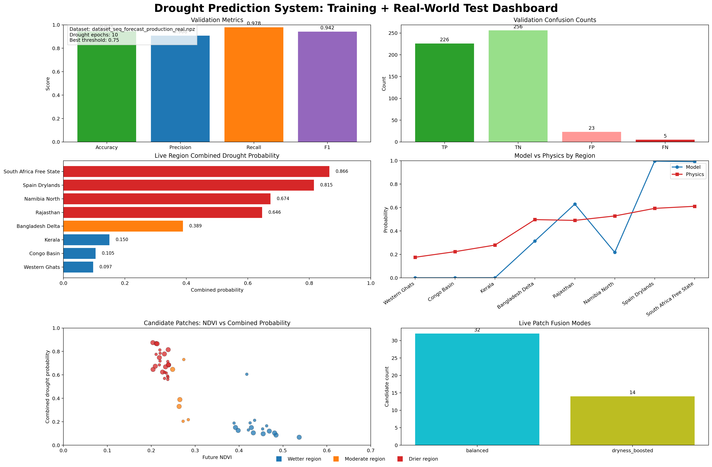

# AURORA-JALADRISHTI

Integrated satellite intelligence for drought monitoring, spectral reconstruction,
and resource-aware mission planning.

**Live application:** https://astrobaddies.netlify.app/  
**Repository prepared for upload:** `ASTRO_BADDIES/`

## What it does

AURORA-JALADRISHTI addresses drought monitoring when spacecraft have limited
observation, energy, storage, and communication budgets. An RGB observation is
passed through `SpectralNetV10` to reconstruct six Sentinel-2-style bands
(B02, B03, B04, B08, B11, B12). Temporal features then produce a drought-risk
estimate. The AURORA planner ranks candidate observations by information gain
per resource cost, selects a feasible target, and performs an explicit simulated
belief update.

The planner is a research simulation, not live spacecraft telemetry.

## Architecture

```text
RGB observation
  -> spectral reconstruction (six bands)
  -> temporal drought forecasting
  -> drought-risk estimate
  -> AURORA observation selection
  -> simulated belief update and replanning
```

See [docs/ARCHITECTURE.md](docs/ARCHITECTURE.md) for module-level details.

## Features and demo

- Mission-control dashboard with overview, spectral lab, drought lab, mission
  control, scenarios, and research views.
- Local RGB-to-six-band inference API.
- Resource-aware observation ranking with battery and storage constraints.
- Reproducible research artifacts and limitations.
- Static Netlify deployment configuration.

Use the live site for the UI demonstration. For local setup, see
[docs/DEMO_GUIDE.md](docs/DEMO_GUIDE.md).



The repository includes genuine experiment figures and a real sample input.
Screenshots that require a particular browser state are listed in
[docs/screenshots/README.md](docs/screenshots/README.md); no concept mockups
are presented as evidence.

## Verified results

These values are copied from the recorded production artifacts and are not
claims about operational performance:

| Metric | Value |
| --- | ---: |
| Spectral reconstruction RMSE | 0.02523 |
| Drought validation accuracy | 0.9373 |
| Drought validation precision | 0.8933 |
| Drought validation recall | 0.9784 |
| Drought validation F1 | 0.9339 |
| Drought validation AUC | 0.9526 |
| Integrated end-to-end drought F1 | 0.9324 |

Standalone model metrics and integrated pipeline metrics are distinct. The
mission-planning figures are simulation outputs, not predictive accuracy
metrics.

## Repository layout

- `frontend/` - source copy of the static mission-control UI.
- `netlify/` - standalone folder to upload or deploy directly with Netlify.
- `backend/` - local inference API and demo snapshot.
- `FINAL_PROJECT_NASA/` - end-to-end model source, tests, artifacts, and
  selected checkpoints.
- `AURORA/` - mission-planning and scientific validation code/results.
- `tests/` - focused pipeline and planner tests.
- `docs/` - architecture, deployment, testing, data, and reproduction guides.
- `competition/` - judge-facing submission materials.
- `research/` - research paper and spectral reconstruction report.

## Netlify deployment

For the simplest deployment, use the `netlify/` folder. In Netlify, either
upload that folder directly or connect this repository with:

```text
Base directory: netlify
Build command: leave blank
Publish directory: .
```

The hosted site runs as a static demo. It includes the bundled regional
forecast and verified sample reconstruction; the private PyTorch checkpoint is
not shipped, so arbitrary-image inference requires the local backend.

## Quick start

From this directory on Windows:

```powershell
py -3.11 -m venv .venv
.\.venv\Scripts\python.exe -m pip install -r .\FINAL_PROJECT_NASA\requirements.txt
.\.venv\Scripts\python.exe -m pip install -r .\backend\requirements-research.txt
```

Run the local API and open the dashboard:

```powershell
.\.venv\Scripts\python.exe .\backend\mission_api.py
# Open http://127.0.0.1:8000/mission-control.html
```

Run focused tests:

```powershell
.\.venv\Scripts\python.exe -m pytest .\tests
```

The full training dataset is intentionally not bundled. See
[docs/REPRODUCIBILITY.md](docs/REPRODUCIBILITY.md) and
[docs/DATA_SOURCES.md](docs/DATA_SOURCES.md).

## Limitations

- Validation is not a strict geographic holdout for every reported run.
- Drought labels are predominantly proxy-derived.
- The large tensor dataset is excluded; exact retraining requires local data
  acquisition and preprocessing.
- Mission access windows, cloud probability, resource use, and belief updates
  are simulated heuristics.
- Results depend on data, preprocessing, seeds, hardware, and dependency
  versions. This is not an operational alerting system.

## License and acknowledgements

Source code is MIT licensed; see [LICENSE](LICENSE). Data and external
services retain their own terms. Dataset provenance and acknowledgements are
documented in [docs/DATA_SOURCES.md](docs/DATA_SOURCES.md).

